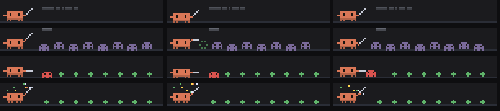

# test-arena

A Claude Code mod. Clawd fights your test runs above the prompt: green kills a monster, red ones fight back. /test-arena shows or hides it.



*Preview frames rendered from the mod's own drawing code.*

**It won't use any of your usage.** Everything is drawn locally from code: no model calls, no tokens.

## Install

```
/plugin marketplace add saiharsha03/test-arena
/plugin install test-arena@test-arena
```

Or from a clone: `claude --plugin-dir ./test-arena`.

## Where it shows

In the band above the prompt, hidden until `/test-arena`. Terminal only.

## Commands

- `/test-arena`

## What the hooks do

`hooks/register.tsx` hooks: session.start, command.run{command=test-arena}, tool.call{tool=Bash}, ui.render{component=AbovePrompt}. It never blocks or rewrites a tool call or a prompt; it only watches them, draws, and answers its own commands.

## Privacy: what data it sends

None. It makes no network or model calls; anything it remembers stays in Claude Code's local plugin storage on your machine.

## Licence

MIT. Clawd is Anthropic's Claude Code mascot; this is an unofficial fan mod.
